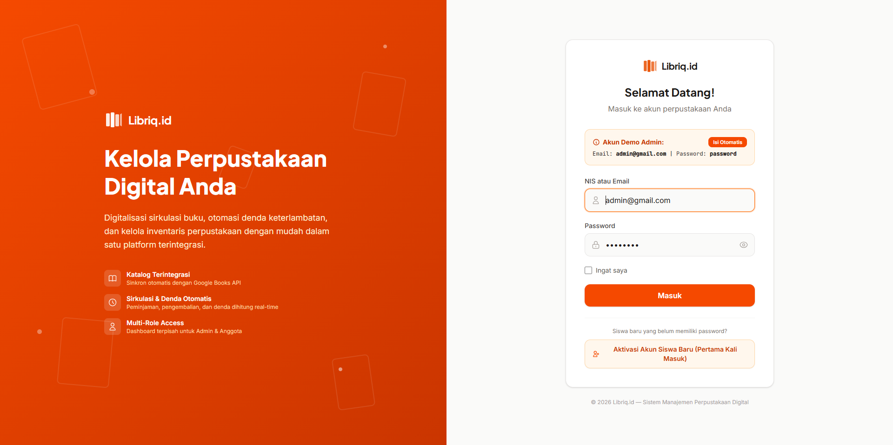
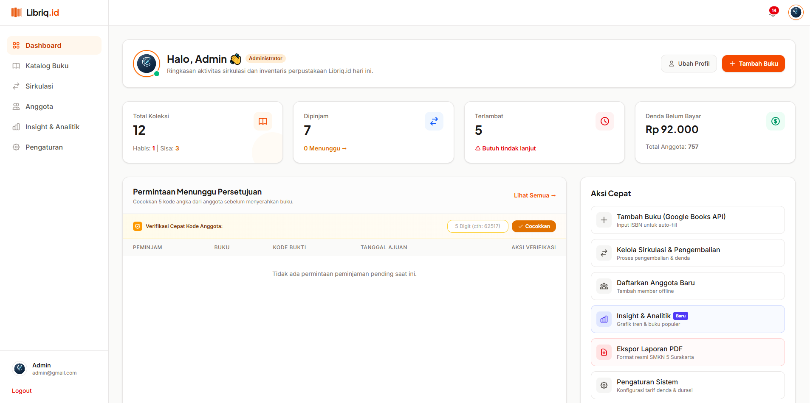
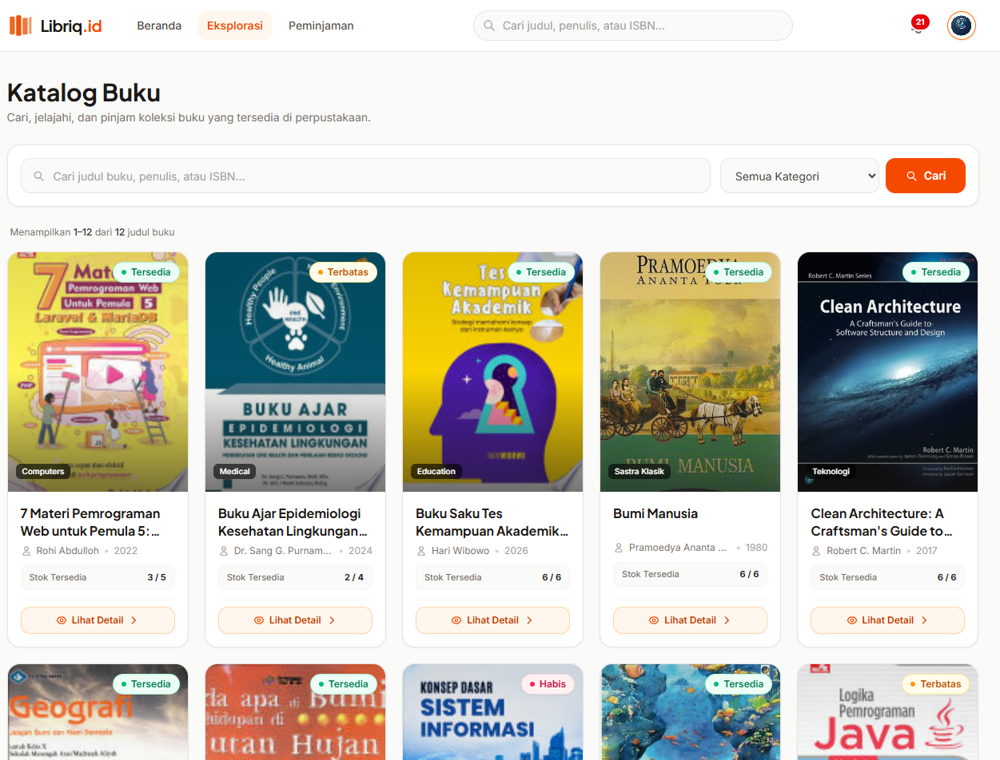

# 📚 Libriq.id — Sistem Manajemen Perpustakaan Digital

Platform manajemen perpustakaan modern berbasis web yang mendigitalisasi alur sirkulasi buku fisik — mulai dari pencarian katalog, peminjaman, pengembalian, hingga perhitungan denda keterlambatan secara otomatis.

---

## 🌐 Link Hasil Hosting
Aplikasi telah di-deploy dan dapat diakses publik melalui:  
👉 **[https://libriq-id-b5rwx.sprites.app](https://libriq-id-b5rwx.sprites.app)**

---

## 📖 Deskripsi Singkat
**Libriq.id** dirancang untuk mentransformasi sistem administrasi perpustakaan konvensional menjadi ekosistem digital yang efisien, transparan, dan terintegrasi. Proyek ini bertujuan untuk memudahkan pustakawan dalam mengelola inventaris buku dan transaksi sirkulasi, sekaligus memberikan kemudahan bagi siswa/anggota perpustakaan dalam mengeksplorasi koleksi buku, melakukan peminjaman mandiri, dan memantau status denda secara real-time.

---

## 🚀 Fitur Utama

### 👨‍💼 Panel Administrator (Pustakawan)
- **Ringkasan Statistik Dashboard:** Monitoring cepat total judul buku, sirkulasi aktif, buku jatuh tempo (*overdue*), dan akumulasi pendapatan denda.
- **Katalog Manajemen Hybrid:** Pengelolaan data buku dengan integrasi pencarian data metadata otomatis via Google Books API maupun input manual.
- **Sistem Sirkulasi & Validasi:** Memvalidasi permohonan pinjam, pemrosesan pengembalian, dan konfirmasi pembayaran denda.
- **Manajemen Pengguna:** Pengelolaan data akun siswa/anggota beserta informasi kelas dan NIS.

### 🧑‍🎓 Portal Siswa / Anggota (Member)
- **Eksplorasi Katalog (*Cover-first Grid*):** Tampilan visual sampul buku yang menarik, dilengkapi filter kategori cepat dan indikator ketersediaan stok fisik (*Tersedia, Sisa Sedikit, Habis*).
- **Pengajuan Peminjaman Mandiri:** Proses reservasi atau pengajuan pinjam buku secara langsung melalui sistem.
- **Riwayat & Tagihan Denda:** Pemantauan tanggal jatuh tempo serta rincian transparansi denda keterlambatan.

---

## 🛠️ Teknologi yang Digunakan

### Backend & Database
- **Framework:** [Laravel 12](https://laravel.com/) (PHP 8.5)
- **Database:** SQLite
- **Autentikasi & Session:** Laravel Session-based Auth & Role-Based Access Control

### Frontend & Styling
- **HTML5 & Blade Templating Engine**
- **Styling:** [Tailwind CSS v4](https://tailwindcss.com/) (Modern Utility-First Styling)
- **Interaktivitas:** [Alpine.js](https://alpinejs.dev/) (Komponen reaktif ringan)
- **Tipografi:** Plus Jakarta Sans & Inter Fonts

### Cloud Infrastructure
- **Hosting Platform:** [Fly.io Sprites](https://fly.io/sprites) (Hardware-isolated MicroVM dengan persistent storage)

---

## 📸 Screenshot Tampilan Project

*(Simpan gambar tangkapan layar ke dalam folder `public/images/screenshots/` dengan nama file yang sesuai di bawah)*

### 1. Halaman Login & Registrasi

### 2. Dashboard Administrator

### 3. Katalog Buku (Member Portal)

---

## 👤 Identitas Pembuat
- **Nama:** Almay Sonhaji
- **No. Absen:** 06
